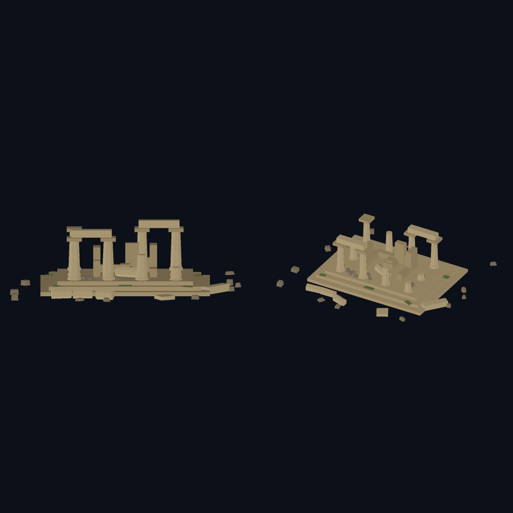
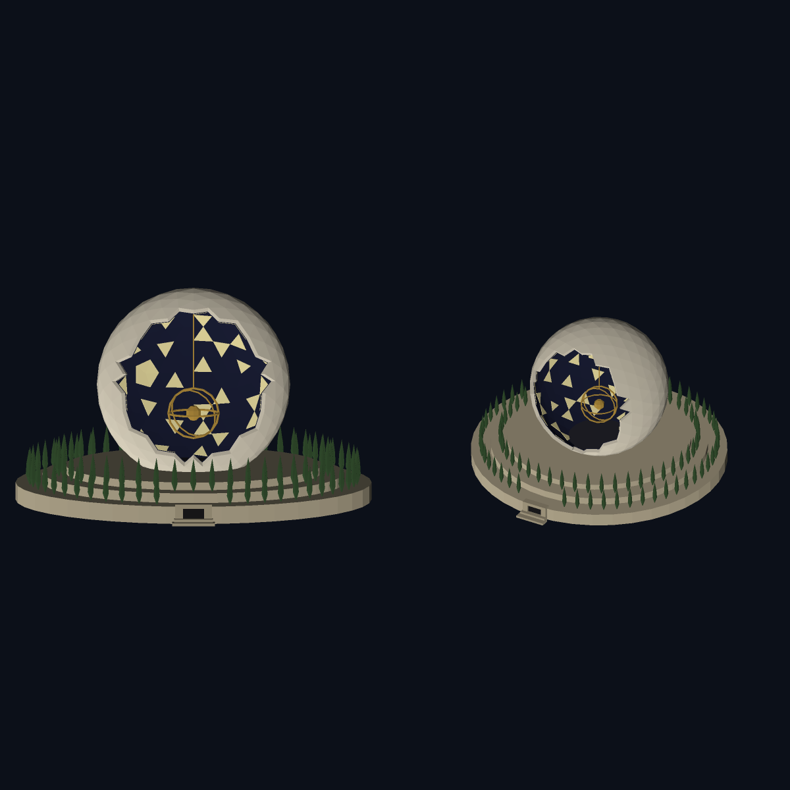
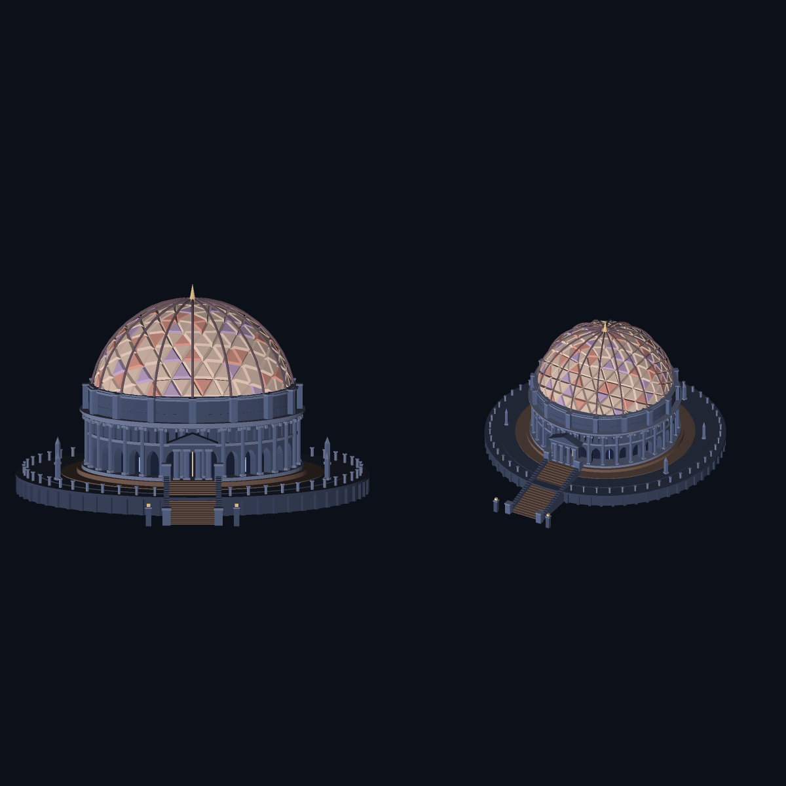

# scadify

Geometry as code: deterministic 3D solids generated from tiny JSON recipes with OpenSCAD inside, compiled on demand to clean meshes and exported as glb, gltf, stl, 3mf, usdz, usda or scad. The same recipe, seed and params give byte-for-byte identical output on the same platform. One runtime dependency (`openscad-wasm-prebuilt`, in-process OpenSCAD + Manifold); everything else is Node stdlib. Node ≥ 18.

## The pattern

A **recipe** is a small JSON file in `store/` (one per ref). It is the only thing stored; meshes are derived and disposable. Same recipe + params + seed ⇒ same bytes on the same platform.

```jsonc
{ "kind": "scad",            // "scad": the program is the source | "csg": a boolean tree of primitives
  "title": "demo-tray", "units": "dm", "seed": 7,
  "program": "module tray(){ ... }",
  "parts": { "tray": "tray();", "standoffs": "standoffs();" },   // one mesh/node per part
  "params": { "wall_h": 12 },                                    // passed as -D, so they override program defaults
  "tints": { "tray": "#3f6fb0" } }                               // optional #rrggbb per part
```

`kind:"csg"` uses `tree` (or `parts`) instead of `program`: nodes `{op, ...}` with ops `cube cylinder sphere translate rotate scale mirror union difference intersection hull`; transforms/booleans take `children`. A number may be `{"param":"name"}`. A csg recipe transpiles to `.scad` (`export_solid format=scad`). `seed` is injected as the OpenSCAD variable `seed`. Parts are emitted in sorted-name order.

**Units.** `units` is one of `mm`, `cm`, `dm`, `m` (metres per unit 0.001, 0.01, 0.1, 1) and defaults to `dm` when omitted, so architectural models land at true size (1 unit = 10 cm). Recipe coordinates are in that unit. Exports are normalized so imports land at true size with scale 1: GLB and USD are written in **metres** (`metersPerUnit` 1), STL and 3MF in **millimetres**. Previews render the raw recipe coordinates.

## Tools (stdio MCP, hand-rolled JSON-RPC; `node src/scadify-cli.mjs`)

| tool | does |
|---|---|
| `mint_solid {recipe}` | store a recipe → `{ref}` (`slug-<hash8>`; identical content is idempotent) |
| `list_solids` / `get_solid {ref}` | list refs / return the recipe |
| `update_solid {ref, params?, program?, parts?, tree?, title?, seed?, tints?}` | edit in place (params merge, rest replace; ref is stable) |
| `export_solid {ref, format}` | compile + write `out/<ref>.<format>`, `format` = `glb gltf stl 3mf usdz usda scad json` → `{path, format, sizeBytes, sha256, ref}` |
| `render_turntable {ref, frames=8 (3–36), size=256, elevation_deg=25}` | PNG frames from the in-Node software rasterizer (transparent background) |
| `render_shot {ref, angle_deg=0, elevation_deg=26, size=512, background='#0C1019'}` | exactly one PNG; angle 0 = model front (-y), camera orbits +z; `background` is `#rrggbb` or `transparent` → `{path, size}` |
| `render_standard {ref, size=1024, background='#0C1019'}` | standard preview: one square PNG, front-on shot (0°, 8° up) left and angled-high shot (30°, 32° up) right → `{path, size, panels}` |
| `measure_solid {ref}` | bbox, size, volume, area, triangle count, mesh checksum |

Env: `SCADIFY_STORE`, `SCADIFY_OUT` override the `store/` and `out/` dirs. The bin also has a one-shot CLI: `scadify tools`, `scadify call <tool> --json '{...}'`.

## Output notes

- **GLB/glTF**: mesh only. One flat node per part, one mesh/material (PBR baseColor from the tint). No cameras, lights, ground plane, transforms, or hierarchy. Node, mesh and material names are the part names (a numeric suffix only if a name repeats). Coordinates are in **metres**, **z-up** (not glTF's y-up convention); glTF has no ratified units extension, so this is declared in `asset.extras` (`units: "m"`, `metersPerUnit: 1`, `sourceUnits` = the recipe's unit, `upAxis`). A strict y-up viewer will show the model lying on its side.
- **USDA/USDZ**: `upAxis="Z"`, coordinates in metres with `metersPerUnit = 1`, one Xform per part named after the part and holding a Mesh of the same name, UsdPreviewSurface materials; USDZ is a stored zip with 64-byte-aligned payload. The editing/postprocess path.
- **STL** (binary) and **3MF** (`unit="millimeter"`, one object per part) for print. Both are always written in millimetres: coordinates are converted from the recipe unit (×1, ×10, ×100, ×1000 for mm, cm, dm, m) so a slicer reads true size. **SCAD** is the assembled program.
- Not verified here: opening the files in third-party viewers (Blender, Quick Look, a slicer). Tests re-read each format structurally only.

## Examples

`examples/` ships three showcase solids. Each is a single JSON file: the `program` is plain OpenSCAD (loops, `rands(…, seed)`, list comprehensions, an in-language geodesic sphere), and `parts` are the unit of tinting. Any of them mints, compiles, exports and renders with the identical loop:

```bash
npm install
REF=$(node src/scadify-cli.mjs call mint_solid --json "{\"recipe\": $(cat examples/domed-citadel.json)}" | node -pe 'JSON.parse(require("fs").readFileSync(0)).ref')
for f in glb stl usdz; do node src/scadify-cli.mjs call export_solid --json "{\"ref\":\"$REF\",\"format\":\"$f\"}"; done
node src/scadify-cli.mjs call render_turntable --json "{\"ref\":\"$REF\",\"frames\":8,\"size\":256}"
node src/scadify-cli.mjs call measure_solid --json "{\"ref\":\"$REF\"}"
```

Files land in `out/`. `npm test` runs the suite (node:test).

### Temple ruins — `examples/temple-ruins.json`

A ruined stepped temple: hex peristyle with broken columns, crumbled cella, fallen drums and rubble. 8 parts, ~1.2k tris. `seed` drives the crumble and scatter.



### Newton Cenotaph — `examples/newton-cenotaph.json`

Boullée's cenotaph: a hollow **geodesic sphere** (generated in OpenSCAD) on stepped drums with cypress rings. `variant: 2` (default) opens a front cutaway to the navy-lined, gold-starred interior; set `variant: 1` for the closed shell with star openings. `freq` tunes the sphere (6 ≈ 9.3k tris).



### Domed citadel — `examples/domed-citadel.json`

A monumental domed building: fluted terrace, 32-bay two-storey drum with pointed-arch bays and slit windows, portico + grand stair, and a ribbed geodesic dome whose facets are three-colour raised panels. 12 parts, ~26.9k tris, `dome_freq` controls the dome.



Units are per recipe (`mm`/`cm`/`dm`/`m`, default `dm`; the three examples are `dm`), z-up, front faces −y. The preview renders are unit-independent. The same `seed` re-mints byte-identical geometry on the same platform.

## Claude plugin

`.claude-plugin/plugin.json` declares the stdio server as an `mcpServers` component (`node ${CLAUDE_PLUGIN_ROOT}/src/scadify-cli.mjs`); there is no top-level `bin/`. The plugin needs `openscad-wasm-prebuilt` installed alongside (`npm install`, or bundle `node_modules/`).
